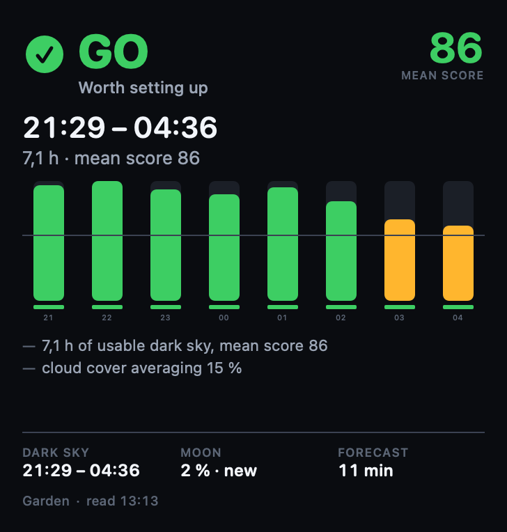
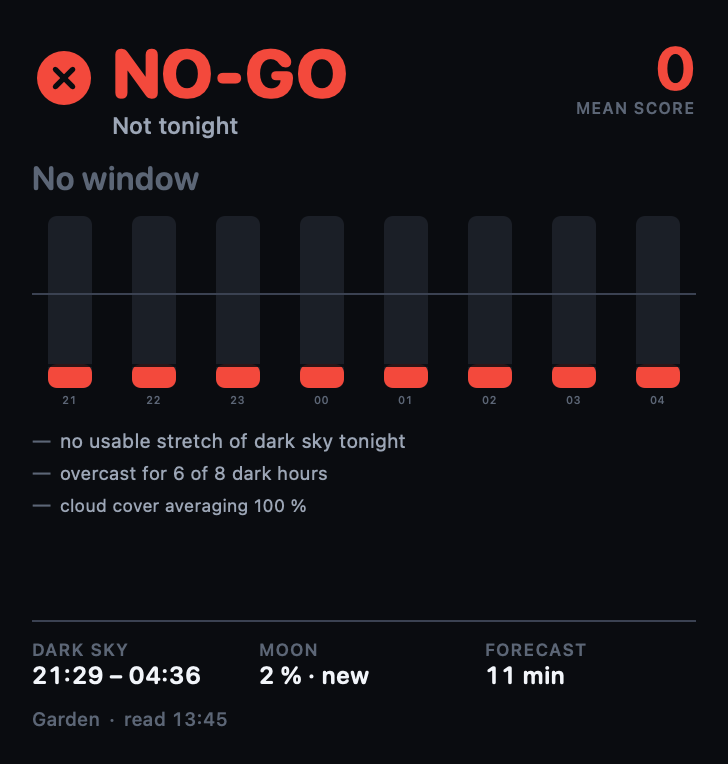
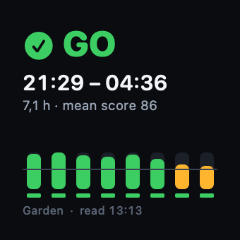
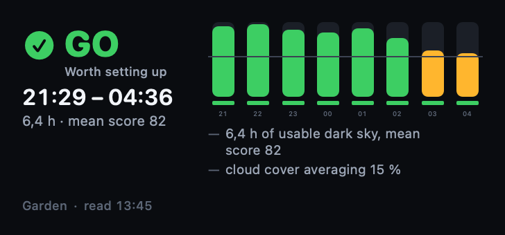
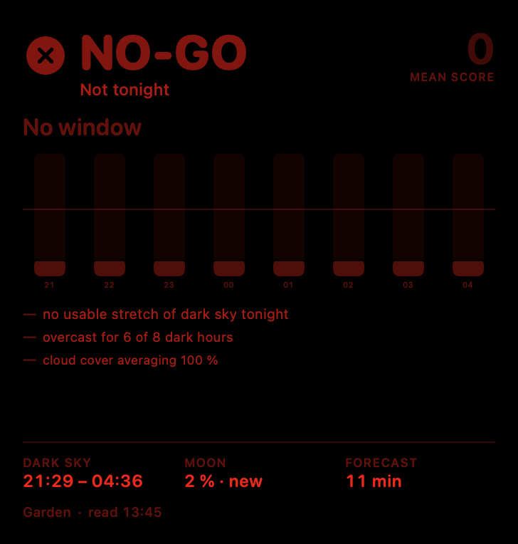
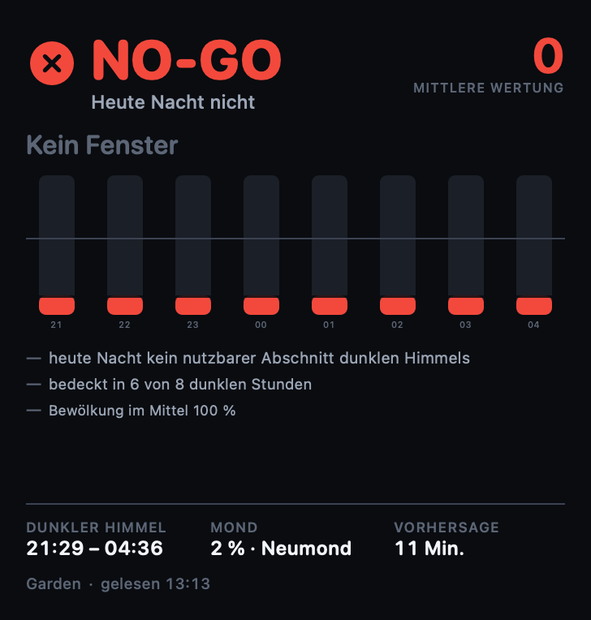

# Launch Window — the client

A small SwiftUI app and a widget for iPhone, iPad and Mac. They read
`GET /api/v1/beacon` from the beacon in the hallway and put tonight's verdict on
a home screen, a Lock Screen or a desktop, so that the answer arrives without
anyone opening anything.

<table>
<tr>
<td width="50%"></td>
<td width="50%"></td>
</tr>
<tr>
<td valign="top"><sub><b>GO</b> — the large widget. The bar under each hour marks the recommended window; the hairline across the strip is the firmware's <code>usable_score</code> of 55.</sub></td>
<td valign="top"><sub><b>NO-GO</b> — the same night as the beacon actually graded it. Vetoed hours are drawn as refusals, not as short bars.</sub></td>
</tr>
</table>

## What it shows, and what it refuses to show

The [protocol](../protocol/beacon-v1.md) holds itself to three rules. A client
that ignored them would be worse than no client, because it would look
authoritative while being wrong. So:

**A stale value is never presented as a current one.** There are two ways this
answer can go out of date and they are different, so the app distinguishes them.
The beacon's own `data.stale` means the forecast half is old — the banner says
so, above the verdict, and says explicitly that the darkness and the Moon are
not affected. Separately, *this* client may have failed to reach the beacon at
all, in which case it shows the last document it managed to read, labelled with
how old it is and marked with a struck-through aerial. Neither is ever silently
passed off as fresh.

**Nulls are honest.** `unknown` is drawn as its own state, never as `no-go`:
one says the sky is bad, the other says the beacon has no forecast. An hour
whose cloud cover came back null is drawn as a dashed outline rather than as a
zero-height bar, because it was excluded from the night, not graded badly.

**Unknown fields are ignored.** New fields may appear within version 1. The
models decode what they know and drop the rest, and the cache stores the bytes
the beacon actually sent, so nothing this client does not model is lost on a
round trip. A `schema` other than 1 is refused outright rather than guessed at.

## The sizes

Each one answers a different question rather than being the same view scaled.

| Family | What it adds |
|---|---|
| Small | The verdict and the window. Nothing that cannot be read walking past. |
| Medium | The night hour by hour — what turns "no" into "no, it only clears after three". |
| Large | The reasons, and the sky they are about. |
| Extra large | The numbers each hour was graded from, so the verdict can be argued with. |
| Lock Screen | Circular, rectangular and inline. One tint, so the symbol carries the state. |

<table>
<tr>
<td></td>
<td></td>
</tr>
</table>

## Night vision

Off by default, because a widget is mostly read in daylight and the LED's own
colour language — green, amber, red — says more at a glance than a monochrome
panel can. Turned on, everything is deep red on black, the way the beacon's own
status page is, and the verdict is carried by its symbol and by intensity rather
than by hue. Somebody reading this at one in the morning has spent half an hour
becoming dark-adapted, and a green tile at full brightness costs them that.

The app has the setting; each widget can follow the app, or override it, because
a widget on a desk at work and one on a phone that lives in an observing bag
want different answers.

<table>
<tr>
<td width="50%"></td>
<td width="50%"></td>
</tr>
<tr>
<td valign="top"><sub>Night vision.</sub></td>
<td valign="top"><sub>German. The beacon's own sentences are translated too — see below.</sub></td>
</tr>
</table>

## The nights after this one — a proof of concept

The beacon answers about one night. `app/Shared/SkyMath.swift` and
`app/Shared/VerdictEngine.swift` are Swift ports of `firmware/lib/sky.py` and
`firmware/lib/verdict.py`, which lets this client grade the rest of the week
from a forecast it fetches itself.

**This duplicates the project's core judgement, which is a real cost.** It was
taken because the alternatives are worse: the board already fails intermittently
to allocate the 4 kB its own document needs (`json_response` builds it as one
contiguous string), so growing that document is the wrong direction, and a
firmware endpoint serving future astronomy would still need that fixed first.
Nothing in the outlook touches the beacon.

What makes the duplication bearable is that it is checked, three ways:

| Check | What it holds | Result |
|---|---|---|
| `tools/compare-sky.py` | Swift astronomy against `sky.py`, four sites including one with no astronomical night and one in the southern hemisphere | 1460 nights, 0 disagreeing |
| `tools/compare-verdict.py` | Swift grading against `verdict.py` over constructed nights — moonlit, gusty, dewy, clearing at three, with holes in the cloud series | 300 cases, all four states, 0 disagreeing |
| `OutlookEngine.selfCheck` | the engine regrades *tonight* from the raw values in the beacon's own document and compares | runs on every refresh, in the app |

The third is the one that keeps working after this is written. The beacon
publishes each hour's measured cloud, gusts, temperature, dew point and
precipitation alongside the grade, which makes its document a complete input to
the engine and therefore a complete test of it. If the two ever disagree, the
outlook panel says so and tells the reader to distrust everything below it.

It has already earned its place: the bundled `goNight` sample used to carry
scores written by hand, and the self-check caught them — an engine regrading
those raw values got 85.9 where the document claimed 82.2, because the document
was fiction. `tools/make-samples.py` now grades the sample with `verdict.py`
itself.

Two smaller decisions worth stating. The outlook starts at **tomorrow**: the
beacon has already answered for tonight, from its own forecast, and a second
opinion on the same screen could differ slightly and read as a fault — that
comparison happens once, deliberately, in `selfCheck`. And the forecast comes
from **Open-Meteo**, the same source the beacon uses, rather than from WeatherKit
which is already on the device and would need no client at all; one source means
tonight and Thursday are comparable, which is the entire point of a column of
nights.

Confidence is drawn, not claimed: nights beyond three days are rendered faintly,
and the panel says in words that hourly cloud that far out is a hint rather than
a forecast.

**Not done, deliberately.** The outlook is app-only — no widget shows it yet,
and the widget's refresh budget and the extra Open-Meteo call are the questions
to settle before it does.

## German and English

The interface follows the system language. The beacon, though, generates its
verdict reasons as English strings on the device — `overcast for 6 of 8 dark
hours`, `cloud cover averaging 100 %` — and shipping those untranslated would
leave the most informative part of the screen in the wrong language.

They are a closed set of templates in
[`firmware/lib/verdict.py`](../firmware/lib/verdict.py), so `Reasons` in
[`Shared/Strings.swift`](Shared/Strings.swift) matches each one, pulls the
numbers out and re-renders it in the reader's language with their number
formatting. A sentence that matches nothing is shown exactly as the beacon said
it — untranslated, never dropped, which is how this degrades when the firmware
learns to say something new.

Every user-facing string has an explicit key, so the catalogue is a contract
that can be checked rather than eyeballed:

```sh
app/tools/check-strings.py     # keys used ↔ keys translated, both ways, and placeholder shapes
```

## Building it

Copy `Config/Local.xcconfig.example` to `Config/Local.xcconfig` and set your
development team in it. Then open `LaunchWindow.xcodeproj` and run. One
multiplatform app target and one widget extension, both iOS 18 / macOS 15 and up.

```sh
xcodebuild -project app/LaunchWindow.xcodeproj -scheme LaunchWindow \
           -destination 'platform=macOS' build
xcodebuild -project app/LaunchWindow.xcodeproj -scheme LaunchWindow \
           -destination 'platform=iOS Simulator,name=iPhone 17 Pro' build
```

The beacon's address defaults to `launch-window.home` and is editable in the
app. Each widget can also carry its own address — long-press, Edit Widget —
which is how a second beacon at a second site gets a second widget.

**Open the app once before adding a widget.** Since iOS 14 and macOS 15, talking
to anything on the local network needs the user's permission, and only an app
can raise that prompt. A widget extension cannot, so a widget added first will
sit at UNKNOWN until the app has been run once.

### Two configuration details worth knowing

**iCloud Private Relay.** Private Relay proxies exactly two kinds of traffic:
Safari, and *plain HTTP from any app* — which is everything this client speaks.
It is meant to leave local destinations alone, and mostly it does: a successful
read logs `private_relay=false` and `Privacy Stance: Not Eligible`. But it makes
that judgement from the name, and `launch-window.home` is a fully-qualified name
in an ordinary TLD. Before the system has resolved it to a private address, the
relay can take the request, fail to find the host on the public internet, and
answer 502 — which surfaces as:

```
[C1.1.1:2] Received response code 502 for launch-window.home:80, unreachable through proxy
Task <…> finished with error [-1004] … "Could not connect to the server."
```

for a beacon that is switched on and answering `curl` from the same machine. It
is intermittent, and it lands hardest where nobody can retry it: a widget
refreshing in the background, which then shows UNKNOWN for no visible reason.

Two things guard against it. The session sets `connectionProxyDictionary = [:]`,
which asks the networking stack not to proxy at all. And if a request still
fails to connect, `BeaconClient` resolves the host through the system resolver —
`getaddrinfo`, the one that knows about the router handing out `.home` — and
retries once against the literal address, but **only if that address is
private**. A name that resolves to a public address is left alone, because then
the proxy was not in the way, and retrying around it would be this client
deciding it knows better than the network.

Exercise the fallback with `LW_FAIL_BY_NAME`, below; it is otherwise a path that
only runs during a failure nobody can reproduce on demand.

**Transport security.** The beacon has 264 kB of RAM, no TLS stack, and no
certificate it could present for a name like `launch-window.home` if it had one.
So both `Info.plist` files set `NSAllowsArbitraryLoads` — and deliberately do
not set `NSAllowsLocalNetworking` beside it. When that second key is present,
App Transport Security *ignores* `NSAllowsArbitraryLoads` altogether, and it
would not cover this beacon anyway: it reaches unqualified names, `.local` and
literal private addresses, and `launch-window.home` is none of those. Setting
both is the configuration that silently refuses every connection, which is
exactly what it did here until `LW_PROBE` caught it.

**Signing.** The development team is the one value here that identifies the
author rather than the behaviour, so it lives in `Config/Local.xcconfig`, which
is untracked. Copy `Config/Local.xcconfig.example` over it and put yours in.
`Config/Signing.xcconfig` pulls it in with `#include?` — the question mark makes
it optional, so a checkout without it still opens and still builds for the
Simulator, and only fails where signing genuinely needs a team.

That file is also where the App Group gets spelled, because macOS wants the team
in front of the identifier and iOS does not:

```
LW_APP_GROUP = group.de.staticline.astro
LW_APP_GROUP[sdk=macosx*] = $(DEVELOPMENT_TEAM).group.de.staticline.astro
```

One definition reaches all three places that need it: the entitlements use
`$(LW_APP_GROUP)`, so there is a single entitlements file per target rather than
one per platform; the `Info.plist` carries it as `LWAppGroup`; and `SharedStore`
reads that key instead of hardcoding either spelling. The code therefore cannot
disagree with the entitlement it was signed with, and no team identifier is
written down in the repository.

**App Group.** The app and the widget share an App Group so that the address
typed in one is the address used by the other. It is named
`group.de.staticline.astro`, not after this app, because an App Group is per
development team and the useful unit is the toolset rather than the tool — every
astro tool signed by the same team can join it.

The group's other member will be
[`ground-control`](../../astro/ground-control/), the session-monitoring app for
the rig in [`../../astro`](../../astro/). What the arrangement buys is mostly one
thing, and it is worth the whole of it: **night vision is shared**. Dark
adaptation is a property of the observer, not of an application, and a toolset in
which only one app goes red at one in the morning costs its owner the twenty
minutes they spent adapting.

### `astro.nightVision` is three-valued, on purpose

The two tools do not agree on what to do when nobody has expressed a preference,
and both are right. `ground-control` is red on black *by default* — it is read at
the eyepiece, where white light is a functional problem rather than a matter of
taste. Launch Window starts in colour, because a widget is mostly read in
daylight and the LED's own green/amber/red says more at a glance than a
monochrome panel can.

So the shared key carries **only an explicit choice**, and absence is a third
state rather than a synonym for `false`:

| `astro.nightVision` | What a tool does |
|---|---|
| absent | Applies its own default — Launch Window in colour, `ground-control` red |
| `true` | Red on black, in every tool |
| `false` | In colour, in every tool |

The rule that makes this work is that **no tool writes this key at startup.** It
is written only when the observer actually flips the switch, in whichever app
they happen to have open; from that moment every tool obeys. A tool that wrote
its own default on first launch would silently impose its taste on the others,
and which taste won would depend on nothing more meaningful than which app was
opened first.

Everything else is namespaced, because a shared container is a shared key space:

| Prefix | Who it belongs to |
|---|---|
| `astro.*` | Shared on purpose, for every tool in the group |
| `launchWindow.*` | This app and its widget, and nobody else's business |

`SharedStore` still probes: it writes a file in the container, because on macOS
`containerURL(forSecurityApplicationGroupIdentifier:)` returns a path for groups
the process was never granted. If nothing is usable it falls back to per-process
defaults — the entitlement is an improvement, never a dependency, and the
settings screen says which you have.

It does need registering once, and only Xcode can do it: **build for an iOS
device from Xcode before building from the command line.** Automatic signing
then creates the App IDs and reissues the provisioning profile with the App
Groups capability. Until that has happened, a device build fails with
*"Provisioning profile … doesn't support the group.de.staticline.astro App
Group"* — the macOS and Simulator builds are unaffected, because neither needs a
profile. If you would rather not have the capability at all, delete the
`com.apple.security.application-groups` block from all four `.entitlements`
files: everything still works, and the widget then takes its address from its
own configuration instead of from the app.

A shared container is also a shared blast radius: a tool that writes a corrupt
cache hands it to whoever reads next. Launch Window is defensive about this
already — a cached document that will not decode is discarded rather than
trusted — and anything else joining the group should be too.

## Development aids

Two DEBUG-only, macOS-only hooks in
[`LaunchWindow/Development.swift`](LaunchWindow/Development.swift). They exist
because the two things most easily got wrong here are the hardest to look at
from a terminal: a widget cannot be run on its own, and the network path is
guarded by policy that only bites on a real device.

```sh
APP=~/Library/Developer/Xcode/DerivedData/…/LaunchWindow.app/Contents/MacOS/LaunchWindow

LW_PROBE=launch-window.home "$APP"           # read once; report and exit
LW_FAIL_BY_NAME=1 LW_PROBE=… "$APP"          # ... with every by-name request forced to fail
LW_GALLERY=1 "$APP"                          # render every widget size, in every state, to PNG
LW_GALLERY=1 "$APP" -AppleLanguages "(de)"   # ... in German
LW_SELFCHECK=launch-window.home "$APP"       # regrade the beacon's night and diff
LW_OUTLOOK=launch-window.home:7 "$APP"       # the whole outlook, end to end
LW_SKY=<unix>:<nights>:<lat>:<lon> "$APP"    # astronomy, for tools/compare-sky.py
LW_VERDICT='<json>' "$APP"                   # grade one night, for tools/compare-verdict.py
```

`LW_PROBE` reports what the name resolves to and whether that is private, which
App Group resolved and whether sharing is therefore on, the state of
`astro.nightVision`, and then the verdict or the failure. It runs on iOS too,
where the process exits before anything can attach to its stdout — so it also
writes `Documents/probe.txt`:

```sh
xcrun simctl install booted path/to/LaunchWindow.app
SIMCTL_CHILD_LW_PROBE=launch-window.home xcrun simctl launch booted de.staticline.LaunchWindow
cat "$(xcrun simctl get_app_container booted de.staticline.LaunchWindow data)/Documents/probe.txt"
```

The gallery writes 48 images — six states across seven sizes, plus the app
screen — into the sandbox container, and prints the path. The images in `docs/`
came from it.

```sh
app/tools/make-samples.py --host launch-window.home   # refresh the bundled sample nights
app/tools/compare-sky.py "$APP" --nights 365          # Swift astronomy vs sky.py
app/tools/compare-verdict.py "$APP" --cases 300       # Swift grading vs verdict.py
```

The two comparisons need `firmware/lib` on the path, which they arrange
themselves; nothing has to be installed.

## Layout

| Path | What it holds |
|---|---|
| `Shared/Beacon.swift` | The protocol-v1 document, mapped field by field against the spec |
| `Shared/BeaconClient.swift` | The three endpoints, the proxy detour, and what each failure means in words |
| `Shared/IPAddress.swift` | Resolving a name, and knowing a private address when it sees one |
| `Shared/BeaconSnapshot.swift` | One reading, and where it came from — live, replayed, or bundled |
| `Shared/SharedStore.swift` | The App Group, the settings, and the last-known-good document |
| `Shared/Strings.swift` | Every user-facing string, and the beacon's own sentences re-rendered |
| `Shared/Palette.swift` | The LED's colour language, and the night-vision mode |
| `Shared/Components.swift` | The hour strip, the banners, the fact grids |
| `Shared/WidgetLayouts.swift` | The four system sizes, free of WidgetKit so they can be drawn to a file |
| `Shared/SkyMath.swift` | Sun and Moon, ported from `sky.py` (proof of concept) |
| `Shared/VerdictEngine.swift` | The grading weights, ported from `verdict.py` (proof of concept) |
| `Shared/OpenMeteo.swift` | Several days of hourly forecast, from the beacon's own source |
| `Shared/Outlook.swift` | A week of nights, and the self-check against the beacon |
| `LaunchWindow/` | The app: the screen, the model, the settings, the development aids |
| `LaunchWindowWidget/` | The timeline provider, the configuration intent, the Lock Screen sizes |
| `Config/` | Signing, and the App Group spelling derived from it |
| `tools/` | The string checker, the sample generator, and the two engine comparisons |

## Licence

GPL-3.0, with the rest of this repository. Forecast data by
[Open-Meteo](https://open-meteo.com/) under
[CC-BY 4.0](https://creativecommons.org/licenses/by/4.0/); the attribution
travels with anything published from it, a screenshot of a widget included,
which is why the app carries it at the foot of its own screen.
